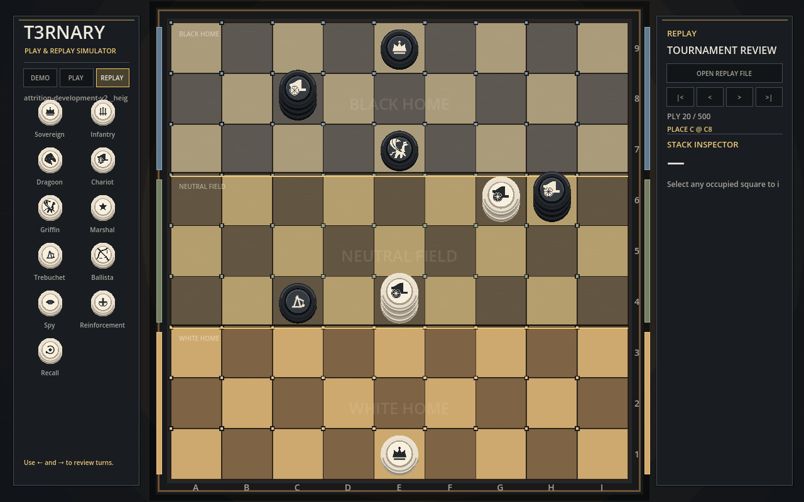

# T3RNARY Simulator

The Godot application opens on the physical tabletop and provides local play
and turn-by-turn replay review through its hamburger menu. Both use the same
GDScript rules engine, session controller, and shared JSON piece catalog as the
automated tests.

The application entry point is `godot/scenes/main.tscn`. The retired drawn
interface remains runnable for reference at
`godot/scenes/legacy/legacy_visual_simulator.tscn`, but it is no longer part of
the primary simulator workflow.

## Play

Choose **NEW GAME** from the hamburger menu to begin a new game.

1. Black selects any square on rank 9, establishing both Sovereigns' distance
   from the nearest edge.
2. White selects either corresponding rank-1 square: on the same side as
   Black or reflected to the opposite side. A center selection has only one
   corresponding square.
3. The opening begins with White's first PLACE.

Use **OPPONENT: HUMAN / COMPUTER** to switch between hot-seat play and the
initial Standard computer opponent. When Computer is selected, choose
**PLAY: WHITE / BLACK** to select your color. The computer can take over either
side of the current game without resetting it. The same search and evaluation
engine plays either side. It
uses deterministic selective search with explicit priorities for immediate
victory, Sovereign safety, exchanges, height-3 threats, mobility, and useful
development. Its conservative four-PLACE opening favors two Infantry foundations
on meaningful Chariot or Dragoon vectors, then develops useful mobile TOP pieces.
A two-Infantry foundation is treated as a deliberate future power Stack rather
than a unit to march around. After the opening, quiet Infantry movement is
strongly disfavored unless it captures, answers a Sovereign threat, opens the
neutral gate, or occurs in a genuine sparse endgame. Mobile TOP choices favor
full-take threats over attrition threats and consider both Sovereigns' attack
geometry.

The tactical evaluation prices every piece in an exposed stack, preserves a
mix of defensive candidates instead of considering only Sovereign retreats,
and selectively extends forcing lines around unresolved Sovereign threats and
immediate 3-Stack captures. Legal Spy conversions use the rules engine's exact
reserve-matching check, so exposed valuable stacks are treated as tactical risks.
Protected capture-and-threat replies are retained during selective search, and
the forced-loss proof rejects disposable blocks that merely postpone the same
unavoidable Sovereign attack.
Ballista and Trebuchet retain extra value while they remain flexible reserve
options, so the computer is less likely to spend them on low-value early shots.
Recall artillery is conserved more strongly, while an emergency shot that
resolves a Sovereign threat remains fully available.
Full 3 Stacks topped by Spy, Ballista, or Trebuchet are treated as sealed,
low-agency enemy material. The computer strongly disfavors reopening them with
attrition and also discounts full-stack and Royal Attack captures while the
opponent can Recall the special TOP piece.
Infantry remains the default development material; the opponent does not hoard
it for hypothetical future defense. Once open play begins, the evaluation adds
urgency to deploying reserve Dragoons, Chariots, Griffins, and Marshals when the
opponent has more active mobile Stacks. Progress toward CONQUER is not rewarded
during an active middlegame; a forward Sovereign escape must stand on its tactical
merits. Conquer progress becomes a positional factor only after the board and
reserves have genuinely thinned. The implementation is intentionally compact
enough for rapid rules testing; it is a baseline opponent, not a claim of
solved play.
When you play White, computer Black chooses the Sovereign band before you select
White's mirrored response. When you play Black, you choose the band and computer
White selects a legal mirrored response before taking White's first action.
Computer search runs away from the drawing and input loop, so the simulator
remains responsive while the status panel reports **COMPUTER THINKING**.
Switching between a human and computer opponent preserves the current game and
its history. The computer can take over its assigned side at any point and will
act immediately when that side is already on turn.

Select a friendly stack once to display its legal MOVE/ATTACK destinations.
Click the selected stack again to inspect it directly on the board: its physical
tiles separate in place and roll out individual TOP PIECE and BURIED labels.
Click the exploded stack a third time to collapse it while keeping the stack
selected; subsequent clicks alternate between these two selected states.
Enemy stacks use the same inspection gesture while showing their movement reach.
Those opponent markers are informational only and cannot execute a move. Click
either discard caddy to fan its captured pieces face-up; click it again to
collapse the pieces back into their two storage rows.
Select a reserve piece beside the board to display its legal PLACE destinations.
MOVE and ATTACK actions animate the complete physical stack from its source to
its destination for either player, including computer turns and forward replay
steps. The next computer action waits for the preceding movement to finish so
individual turns remain visually legible.
Recessed, leather-textured trays beside the wooden board present both players'
reserves as physical pieces. Each pile shows its current count and visibly loses
layers as pieces are played. The larger Infantry supply rests as one horizontal
roll that shortens continuously as pieces are played. A spent group remains
visible as a gray empty outline so the inventory layout does not move or disappear.
Both players' physical reserve caddies remain visible beside the board. Only
the current player's available pieces can be selected during live play.

Placing a Ballista or Trebuchet may create legal SHOOT targets. After choosing
the placement square, select a red target to SHOOT or choose **PLACE WITHOUT
SHOOTING**. Recall first asks which discarded piece will return, then displays
that piece's legal destinations.

Press Ctrl/Cmd-Z to restore the preceding state and Ctrl/Cmd-Shift-Z to move
forward again. Making a different action after Undo clears the redo path.
Escape clears the current selection or dismisses an open overlay.

Every game is automatically recorded after Sovereign setup and after
each action, Undo, or Redo. The version 2 JSON contains the initial state,
current action history, ruleset, outcome, and completion status, so the same
file can be opened in Replay mode or used by later analysis tools. Development
runs save under `research/replays/human`; packaged builds fall back to the
application's `user://human_games` data folder.

Computer games also record an annotation for every AI action: its concise
decision reason, evaluation score, search depth, number of candidates considered,
and tactical diagnostics for premium commitment, Spy exposure, stack exposure,
sealed targets, special-option commitment, enemy 3-Stack pressure, Infantry-move
tempo, development urgency, immediate development threats, reserve mobile units,
and premature Conquer advancement. This makes questionable play reproducible and
gives policy work a concrete audit trail.

Computer Black resigns when an exhaustive one-turn check proves that every
legal Black action allows White to win immediately on the following action by
Sovereign CAPTURE or CONQUER. One surviving defense is enough to continue the
game. Resignation is recorded as the end method without adding a fictional
MOVE or PLACE to the game notation.

New games use the current beta ruleset: four opening PLACE actions per player,
the shared neutral-territory height-3 gate, MOVE and artillery attrition, Royal
Attack, and back-rank Conquer victory.

At game completion, the victory card offers **REVIEW GAME** and **NEW GAME**.
Closing the card, pressing Escape, or choosing Review Game switches the finished
game directly into replay mode at its final ply; no file lookup is required.

## Replay

Choose **OPEN REPLAY…** from the hamburger menu, then open a version 2 replay
JSON file. The picker can be reopened at any time from the same menu. It
defaults to the operating system's list view, including the
file modification timestamp, and starts in `research/replays` when that local
folder is available.

Use the four controls to jump to the initial position, move backward one ply,
move forward one ply, or jump to the final recorded position. The Left and
Right Arrow keys also step backward and forward. The controls and sole current/
total ply readout sit inside the polished metal inlay below the board. Click any
occupied square once to select it, again to
separate and label its pieces on the board, and a third time to collapse it.

When Ballista or Trebuchet placement includes a shot, the physical artillery
tile is aimed toward its recorded target. The direction persists if that tile
is buried and its stack later moves, and replay reconstructs the same facing.

Replay states are reconstructed by applying each recorded action through the
Godot rules engine. If a retired replay contains an action that is no longer
legal under the current engine, review remains available through the last
compatible ply and the simulator reports where reconstruction stopped.

Stack inspection happens directly on the table: select an occupied square and
click it again to separate and label its pieces. **GAME NOTATION** in the
hamburger menu opens a responsive, dismissible table overlay; **COPY** places a complete
notation record through the current position on the clipboard. In Replay mode,
later actions are deliberately excluded so the copied record always matches the
board being reviewed.

## Piece encyclopedia and settings

**PIECE ENCYCLOPEDIA** in the hamburger menu opens an in-game rules reference
without leaving or resetting the current match. It covers every reserve type,
including starting count, notation, battlefield role, movement at each stack
height, placement abilities, and special restrictions. The reference is sized
to the device safe area and can be dismissed with its close control, Escape, or
Android Back.

**SETTINGS** opens the app's expandable settings page. Its first section,
**GAMEPLAY**, contains a persistent **Instructional Feedback** toggle. When
enabled, rejected actions can give a contextual on-table explanation and point
to the relevant play area; the first implemented lesson covers attempts to act
in neutral territory before completing OPENING. Sound and haptic confirmation
for valid action animations remains active when the instructional overlay is
disabled.

**TACTICAL WARNINGS** exposes three independently configurable coaching aids.
CHECK identifies a Sovereign that can be captured immediately. CHECKMATE danger
identifies a threatened Sovereign for which every legal reply still permits an
immediate capture. Major-blunder confirmation pauses an attempted action when
it exposes the player's Sovereign despite the existence of a safe legal action.
The player can cancel or deliberately play the action anyway. These warnings do
not alter move legality: the official rules still permit a Sovereign to enter
or remain in danger. Preferences persist locally between launches.

